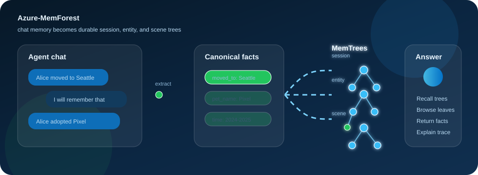

# Azure-MemForest



Azure-MemForest is an enterprise Azure implementation of **MemForest**, a long-memory substrate for agents that turns conversations into durable, queryable memory forests.

The original MemForest research artifact showed how to preserve agent memory as canonical facts organized into temporal trees. This repository extends that idea into a cloud architecture with Azure Container Apps, Cosmos DB, Azure AI Search, Blob Storage, Service Bus, managed identity, Azure OpenAI, Entra authentication, explainability traces, and benchmark parity tooling.

## What Azure-MemForest does

Azure-MemForest gives an agent a memory system that behaves less like a transcript dump and more like a living forest:

1. **Ingest conversations** as ordered turns.
2. **Extract canonical facts** with stable IDs, time anchors, entities, topics, and semantic metadata.
3. **Organize facts into MemTrees** across session, entity, and scene views.
4. **Summarize internal tree nodes** so large memories can be searched coarsely before browsing finely.
5. **Project committed memory generations** into cloud stores:
   - Cosmos DB for source records, canonical facts, tree nodes, fact locations, manifests, jobs, leases, deletions, and traces.
   - Azure AI Search for managed recall over committed tree roots.
   - Blob Storage for restorable UserForest snapshots and fingerprint artifacts.
   - Service Bus sessions for ordered per-user fallback writes.
   - Durable Functions for long-running ingest orchestration when enabled.
6. **Query memory** by recalling trees, browsing tree nodes, loading facts, adding gated lexical fact fallback for update/count questions, reranking with stored fact embeddings plus recency, and composing grounded answers.
7. **Explain decisions** through safe trace records that expose recall, browse, rerank, and answer steps without raw prompt or memory payload leakage.

### MemTree views

MemForest stores the same extracted facts through three complementary tree views:

| View | Organizes | Useful question |
| --- | --- | --- |
| **Session** | Conversation turns in temporal order. | “What happened in this conversation?” |
| **Entity** | Facts grouped around people, organizations, tools, places, or named concepts. | “What do we know about this person or topic?” |
| **Scene** | Facts grouped by situation, activity, topic, or recurring context. | “What context does this memory belong to?” |

## Why this exists

Long-running agents need memory that is:

- **Durable** across sessions and deployments.
- **Scoped** per tenant and user.
- **Updatable** without rebuilding everything.
- **Queryable** without putting every past turn into the prompt.
- **Explainable** enough to show which memories shaped an answer.
- **Governed** by identity, audit, retention, and cloud operational controls.

Azure-MemForest is the path from a research artifact to a usable cloud memory service.

## Current status

The dev Azure environment has been built, deployed, and smoke-tested end to end.

- API and worker run on Azure Container Apps.
- Entra bearer-token auth is configured and verified.
- The worker ingests Service Bus session messages and materializes committed memory generations with staged progress and model-call telemetry.
- Durable Functions is validated as the long-running ingest orchestration path. API-through-Durable smoke, two-ingest hydration smoke, and Phase 1 Durable calibration all completed with Durable instances reaching `Completed`.
- The chat-first UI persists user and assistant turns; assistant turns are retained for transcript history but marked to skip memory extraction.
- Clear-memory is a real asynchronous job, not a UI-only reset.
- Role-based model routing is deployed; the current dev environment uses `gpt-4-1-mini-dev` for chat/memory/answer roles and `text-embedding-3-small-dev` for embeddings.
- Cloud query returns grounded answers from latest committed memory and includes a guarded lexical/recency fallback for knowledge-update/count questions.
- Query trace readback is implemented.
- Build provenance and dirty-tree image guards are in place.
- Benchmark/parity run folders now include lightweight experiment manifests and Durable calibration artifacts.

The project has shipped a large goal-driven backlog covering ingest, query, routing, clear-memory, UI observability, and experiment tracking.

## Architecture

```text
Client / Agent
    |
    |  Ingest / Query / Delete
    v
Azure Container Apps API
    |
    |  accepted write job
    v
Service Bus session queue  ----->  Worker Container App
    |                                 |
    |                                 | acquire per-user lease
    |                                 | hydrate latest snapshot
    |                                 | run MemForest core
    |                                 | project committed generation
    |
    +-- optional Durable start ---->  Durable Functions orchestrator
                                      |
                                      | materialize_write_job activity
                                      | reuse MemForestMaterializationHandler
                                      v
       +----------------------+----------------------+----------------------+
       |                      |                      |                      |
   Cosmos DB              Azure AI Search        Blob Storage          Azure OpenAI
   source of truth        tree-root recall       snapshots             extraction,
   facts, trees,          vector index           fingerprint           summary,
   manifests, jobs,                             artifacts              query,
   leases, traces                                                      answer
```

### Write path

There are two write execution modes:

- **Service Bus mode** is the safe default and remains the fallback for `delete_session` and `clear_memory`.
- **Durable mode** is validated for `ingest_session` and is enabled only in guarded windows or explicit deployments.

Both paths use the same Cosmos job rows, per-user lease, manifest commit boundary, and materialization handler. The Service Bus worker is intentionally strict and observable:

1. Accept a Service Bus message scoped by `tenant_id:user_id`.
2. Claim the job in Cosmos DB.
3. Acquire a fenced per-user write lease.
4. Report job stage `hydrate`.
5. Read the latest committed manifest and hydrate the previous UserForest snapshot from Blob Storage.
6. Report job stage `extract_build`.
7. Apply ingest or delete through the synchronous MemForest core: extract facts, dedupe, route to session/entity/scene trees, summarize, and embed.
8. Report job stage `manifest_pending`.
9. Create a pending forest manifest.
10. Report job stage `project`.
11. Project facts, trees, locations, embeddings, Search documents, summaries, snapshots, and fingerprints.
12. Report job stage `write_projection`.
13. Write the projected records to Cosmos DB, Azure AI Search, and Blob Storage.
14. Assert the lease is still current.
15. Report job stage `commit`.
16. Commit the new manifest.

Only committed manifests are visible to query readers.

Job status now includes:

- `stage`: current worker stage.
- `stage_started_at`: current stage start time.
- `stage_history`: capped history of completed stages.
- `telemetry`: model-call counts and latency by operation/deployment.

`GET /v1/users/{user_id}/jobs/{job_id}/events` exposes the same staged progress as timeline events.

Durable ingest adds a second status source: Durable instance ID equals Cosmos `job_id`, so a write can be correlated across API job status and Durable orchestration state.

### Clear memory

`POST /v1/users/{user_id}/memory:clear` creates a Service Bus `clear_memory` job. The worker clears user-scoped source turns, facts, trees, manifests, browse embeddings, fact locations, recall documents, snapshots, and deletion metadata where configured.

Query traces are not purged by clear-memory; they expire through the Cosmos DB trace container TTL.

Clear has two important reliability properties:

- It records a job row before publishing the Service Bus message, avoiding `job_not_found` races.
- Optional cleanup such as Search/Blob deletion is bounded and best-effort, while critical Cosmos phases remain terminal and visible through job status.

The UI danger-zone clear button submits this job and waits for terminal status before resetting the local view.

### Model routing

Azure-MemForest uses role-based Azure OpenAI deployment names:

| Role | Current purpose |
| --- | --- |
| `chat` / `default` / `extraction` / `dedupe` / `planner` / `browse` | High-volume memory-building and planning work. |
| `answer` | Final grounded answer generation. |
| `summarization` | Env is set to `gpt-5.4`, but most worker summarization paths currently still resolve through the default deployment and appear as `chat`/`default` in telemetry. Full role wiring is pending. |
| `embedding` | Fact, query, and browse embeddings. |

The current dev deployment uses:

- `gpt-4-1-mini-dev` for chat, extraction, dedupe, summarization, planner, browse, and answer roles.
- `text-embedding-3-small-dev` with 1536-dimensional vectors.
- `memforest-recall` as the Azure AI Search recall index.

This mixed strategy avoids routing every internal memory-building call through full GPT-5.4, which caused very long benchmark-session tail latencies.

### Query path

Cloud query follows the MemForest paper semantics:

1. Read the latest committed manifest.
2. Embed the question with the configured Azure OpenAI embedding deployment.
3. Recall candidate tree roots from Azure AI Search filtered by tenant, user, forest version, and embedding model version.
4. Browse Cosmos-backed tree nodes using browse embeddings.
5. Collect leaf fact IDs.
6. Load canonical facts from Cosmos DB.
7. For update/count-style questions, run a scoped lexical fact fallback and filter fallback facts through the latest committed `fact_locations`.
8. Rerank facts using stored extraction-time fact embeddings plus a small recency signal.
9. Compose a grounded answer and reason.
10. Persist safe explainability traces.

## Repository layout

```text
.
├── benchmark/              # Frozen paper benchmark CSVs and baseline summary
├── docs/                   # Azure design, auth, worker, security, production readiness docs
├── infra/                  # Bicep infrastructure for Azure Container Apps and data plane
├── paper/                  # Original MemForest paper assets
├── scripts/                # Build/deploy helper scripts
├── src/
│   ├── build/              # MemTree construction, summaries, node indexes
│   ├── cloud/              # Cosmos, Search, Blob, model, trace, query adapters
│   ├── config/             # Dataclass-backed configuration
│   ├── extraction/         # Chunk extraction and canonical fact management
│   ├── forest/             # UserForest and MemForest orchestration
│   ├── query/              # Local recall, browse, rerank, answer pipeline
│   ├── service/            # FastAPI service, auth, routes, readiness, logging
│   └── worker/             # Service Bus receive loop and materialization runtime
└── tests/                  # Contract, service, worker, cloud, benchmark tests
```

## Azure components

| Concern | Azure service |
| --- | --- |
| API and worker hosting | Azure Container Apps |
| Container images | Azure Container Registry |
| Source of truth | Azure Cosmos DB |
| Recall | Azure AI Search |
| Snapshots and cold artifacts | Azure Blob Storage |
| Ordered writes | Azure Service Bus sessions |
| Model deployments | Azure OpenAI |
| Identity | Microsoft Entra ID and managed identity |
| Observability | Application Insights, Log Analytics, query trace records |

## Development

Use the repo-local virtual environment.

```powershell
python -m venv .venv
$env:PIP_REQUIRE_VIRTUALENV = "true"
.\.venv\Scripts\python.exe -m pip install -r requirements.txt
```

Run tests:

```powershell
$env:PIP_REQUIRE_VIRTUALENV = "true"
.\.venv\Scripts\python.exe -m pytest -q
```

Build a clean ACR image:

```powershell
.\scripts\build_acr.ps1
```

The build script refuses dirty trees and stamps the image with Git SHA metadata.

## Deployment notes

Infrastructure is defined in `infra/main.bicep`.

Important deployment switches:

- `containerImage`: immutable image to deploy.
- `deployWorker`: deploy the worker Container App.
- `workerFactoryReady`: allow the worker to connect to Service Bus.
- `enableDevHeaderAuth`: development-only header auth.
- `deployDurableOrchestrator`: deploy the Durable Functions orchestrator scaffold.
- `durableHostingPlan`: `flex` or `ep1` for the Durable Function App.
- `apiDispatchMode`: `durable` by default for write orchestration; `servicebus` remains available as an explicit direct-worker fallback.
- `durableStartUrl` and `durableStartFunctionKey`: Durable starter endpoint and secret-backed Function key.
- `entraTenantId` and `entraAudiences`: production bearer-token validation settings.

Dev-header auth should remain disabled outside controlled smoke tests.

## Benchmark and parity

Azure-MemForest keeps the original benchmark CSVs and adds deterministic summary/diff tooling:

- `src.evaluation.benchmark_summary`
- `src.evaluation.benchmark_diff`
- `src.evaluation.judge_variance`
- `src.evaluation.cloud_replay`

Current policy:

- Frozen benchmark labels are preserved for reproducibility.
- New cloud parity must compare local and cloud candidates under the same approved judge prompt/deployment.
- Candidate-only methods fail under strict parity.
- Manifest fingerprints record model/config/code inputs for each committed generation.

Cloud experiment outputs live under `docs/parity-runs/`. Each new run should include:

- `manifest.json`: structured run metadata, model stack, dataset/cases, scoring method, metrics, artifacts, caveats, and next gate.
- `report.md`: human-readable analysis and conclusion.
- raw artifacts: case outputs, queue/DLQ snapshots, logs, model environment, query traces, and scoring outputs.

This lightweight tracking is intentional. Azure ML or Foundry eval orchestration should be introduced later, when benchmark runs become scheduled, large, or team-operated.

Recent findings:

- Durable API ingest passed the reliability gate: Phase 1 Durable calibration completed 28/28 ingests, 28/28 Durable instances, 3/3 cases, 0 DLQ delta, and 0 content-filter skips.
- The Phase 1 aggregate initially failed only on case `4b24c848`, a knowledge-update question that answered `3 tops` instead of `five`.
- The correct `five tops` fact was present in the latest projection, but recall/rerank favored the older `three tops` fact.
- A gated lexical fact fallback plus recency-aware rerank fixed the targeted case 2 rerun: answer `Five tops`, both judges correct, 9/9 Durable instances completed.
- The remaining next benchmark gate is rerunning the full 3-case Phase 1 Durable harness with the knowledge-update fix and then deciding whether Phase 2 can proceed.

## Applications

Azure-MemForest can be used anywhere an agent needs durable, explainable, tenant-scoped memory:

- Customer support copilots that remember long-running customer histories.
- Enterprise assistants that keep project, entity, and meeting memory over months.
- Research agents that preserve evolving findings and evidence trails.
- Personal productivity agents with controlled memory retention and deletion.
- Multi-agent systems that need shared, auditable memory state.
- Regulated domain assistants where retrieval must be explainable and deletions must be enforceable.

## Original research artifact

The original MemForest paper assets remain in `paper/`, and benchmark CSVs remain in `benchmark/`. Azure-MemForest preserves the research behavior contract while adding cloud durability, identity, operational readiness, and deployment scaffolding.
